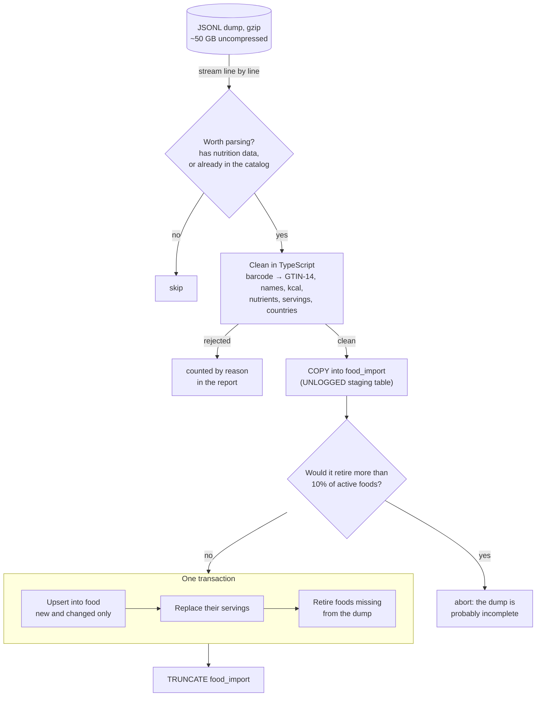

# Catalog service

The food catalog: foods with nutrition values per 100 g or 100 ml, their servings and
barcodes. Imported foods come from [Open Food Facts](https://world.openfoodfacts.org);
users add their own. Built with NestJS and Prisma
([ADR-0007](../../../docs/adr/0007-prisma-database-access.md)) on PostgreSQL;
search uses trigram and full-text indexes
([ADR-0006](../../../docs/adr/0006-postgresql-catalog-search.md)).

## Running it

Prerequisites: the local infrastructure from the [root README](../../../README.md)
(`docker compose up -d`).

```sh
cp apps/services/catalog/.env.example apps/services/catalog/.env
pnpm nx run catalog:prisma migrate deploy   # apply migrations
pnpm nx serve catalog                       # http://localhost:3000/health/ready
```

| Target                                | What it does                                      |
| ------------------------------------- | ------------------------------------------------- |
| `nx test catalog`                     | unit tests                                        |
| `nx run catalog:integration`          | tests against a throwaway Postgres (needs Docker) |
| `nx run catalog:prisma <args>`        | the Prisma CLI, as the migrator role              |
| `nx run catalog:import-off <dump.gz>` | import an Open Food Facts dump (below)            |

## Database access

Each role gets only what it needs ([tools/db/catalog.psql](../../../tools/db/catalog.psql)):

| Role               | Can                                        | Used by                    |
| ------------------ | ------------------------------------------ | -------------------------- |
| `catalog_migrator` | owns the database: create and alter tables | `prisma migrate`           |
| `catalog_app`      | read and write rows (no schema changes)    | the service and the import |
| `catalog_reader`   | read rows; its sessions start read-only    | people, in SQL clients     |

## Open Food Facts import

`node dist/main.js import-off <openfoodfacts-products.jsonl.gz>` reads the full
[Open Food Facts export](https://world.openfoodfacts.org/data) and brings the catalog up
to date with it. A full run reads about 2.1 million products in about 10 minutes and is
safe to repeat: a second run with the same file changes nothing.



### Steps

1. **Lock.** A Postgres advisory lock allows one import at a time. Postgres releases it
   when the connection ends, even after a crash.
2. **Stream and filter.** The dump is never loaded into memory. A cheap text check picks
   the lines worth a `JSON.parse`: products with a nutrition block, plus products already
   in the catalog. Nested objects also have `"code"` keys, so the check may let extra
   lines through, but never misses one.
3. **Clean** (`src/import/off-product.ts`, pure functions with unit tests). A product is
   rejected without a valid barcode, a name, or label energy (estimated energy doesn't
   count), or with implausible values (over 1000 kcal, or macros over 105 g per 100 g).
   Implausible single nutrients become NULL. Barcodes are stored as GTIN-14.
4. **Stage.** Clean rows go into `food_import` with `COPY`, Postgres's bulk-load
   protocol. The table is `UNLOGGED`: faster, and Postgres empties it after a crash,
   which is fine for disposable data.
5. **Safety brake.** Foods missing from the dump get retired. If that would be more than
   10% of the active catalog, the import stops: a truncated download must not wipe the
   catalog.
6. **Merge, in one transaction.** Upsert by `(source, source_ref)`: new foods are
   inserted, changed ones updated, unchanged ones skipped. Then their servings are
   replaced, and foods gone from the dump get `retired_at`. They're never deleted,
   because diary entries refer to them.
7. **Clean up.** `TRUNCATE food_import` frees the space at once (about 1 GB).

### Guarantees

| If…                                | then…                                                                    |
| ---------------------------------- | ------------------------------------------------------------------------ |
| the import runs twice              | the second run changes nothing (idempotent)                              |
| it crashes during the merge        | nothing changed: the transaction rolls back, readers saw the old catalog |
| Postgres itself crashes            | the same; the staging table is emptied on restart                        |
| a second import starts             | it fails fast: "Another import is running"                               |
| the dump is truncated              | the safety brake stops before retiring anything                          |
| a product disappears from the dump | it's retired, not deleted                                                |

### The report

Each run logs one `Import finished` line and a trace (spans `stage` and `merge`):

```json
{
  "read": 2117571,
  "parsed": 1411990,
  "staged": 1313028,
  "rejected": {
    "no_energy": 59140,
    "bad_barcode": 14105,
    "estimated_energy": 13601,
    "…": 0
  },
  "warnings": {
    "estimated_nutrient_dropped": 71040,
    "kcal_macros_mismatch": 64338,
    "…": 0
  },
  "inserted": 0,
  "updated": 0,
  "unchanged": 1313028,
  "retired": 0
}
```

Almost all of the time goes into reading and parsing the dump; the merge takes about a
minute.

### Known gaps

- The export doesn't contain every product Open Food Facts has. Barcodes missing from it
  will be looked up live in the Open Food Facts API.
- Foods fetched that way aren't in the dump, so the retire step will have to leave them
  alone.
