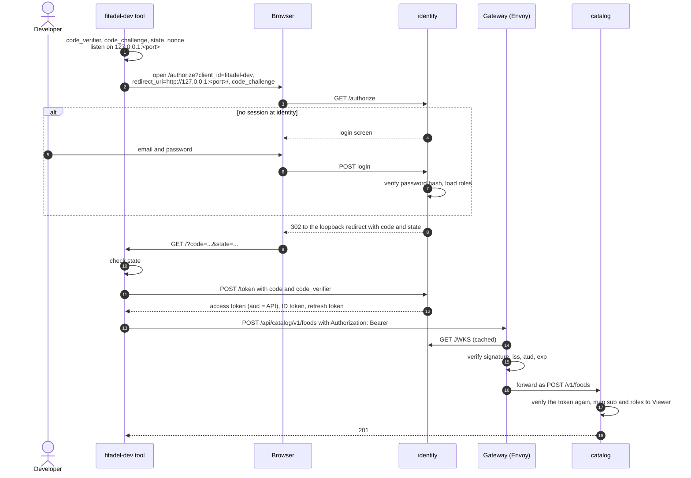

# Authentication and authorization

Fitadel runs its own OpenID Provider, the `identity` service
([ADR-0008](../adr/0008-oidc-provider.md)). Every app and service trusts that one issuer.
External identity providers such as Google sit behind it, so their tokens never reach
Fitadel's APIs.

> **Status:** Phase 2 in progress. Each part below names the step that implements it.
> The catalog accepts `identity`'s access tokens since Step 3; clients go through the
> gateway since Step 4; users can sign in with Google since Step 5.

## Components

| Component       | Role                                                                                                        | Implemented in  |
| --------------- | ----------------------------------------------------------------------------------------------------------- | --------------- |
| `identity`      | OpenID Provider: accounts, login screens, authorization codes, tokens, JWKS                                 | Phase 2, Step 2 |
| `catalog`       | Resource server: verifies access tokens, maps claims to a `Viewer`, applies ownership and contributor rules | Phase 2, Step 3 |
| `diary`         | Resource server: every route needs a token; a user sees only their own goals and entries                    | Phase 3, Step 2 |
| Gateway (Envoy) | Edge: routing, coarse token verification, rate limiting                                                     | Phase 2, Step 4 |
| Google          | External identity provider, federated by `identity`                                                         | Phase 2, Step 5 |

## Clients

| Client            | Type                     | Redirect URI                         | Used by                        | Phase |
| ----------------- | ------------------------ | ------------------------------------ | ------------------------------ | ----- |
| `fitadel-dev`     | Public, PKCE             | Loopback, `http://127.0.0.1:<port>/` | Local tools and manual testing | 2     |
| `fitadel-web`     | Confidential (BFF), PKCE | Web app callback                     | Web app                        | 4     |
| `fitadel-android` | Public, PKCE             | App Link (verified HTTPS)            | Android app, via a Custom Tab  | 5     |

## Tokens

| Token         | Audience   | Format                       | Lifetime                                      | Checked by           |
| ------------- | ---------- | ---------------------------- | --------------------------------------------- | -------------------- |
| ID token      | The client | JWT                          | Short                                         | The client only      |
| Access token  | The API    | JWT, `typ: at+jwt`, ES256    | About 10 minutes                              | Gateway and services |
| Refresh token | `identity` | Opaque, stored by `identity` | Rotated on every use; reuse revokes the grant | `identity` only      |

ID tokens tell the client who signed in and are never sent to an API. Access tokens are
verified locally against `identity`'s JWKS, cached and looked up by `kid`.

## From token to `Viewer`

Services verify the signature, the `alg` allowlist, `iss`, `aud`, `exp` and `typ`, then
map the claims:

| Claim   | `Viewer` field | Notes                                              |
| ------- | -------------- | -------------------------------------------------- |
| `sub`   | `id`           | Fitadel's user ID, stable across sign-in methods   |
| `roles` | `roles`        | e.g. `contributor`, allowed to create public foods |

Role changes take effect when the access token is next refreshed.

Services do this with [`@fitadel/shared-auth`](../../libs/shared/auth): a guard on every
route that requires a token unless the route is marked `@Public()`. A token that is sent
is verified even on a public route, so a broken token is never mistaken for
"anonymous". Expired tokens get `error_description="The access token expired"`, so
clients know to refresh; unreachable keys answer `503`, not `401`.

## At the gateway

Clients reach everything through one origin, the Envoy gateway
([ADR-0009](../adr/0009-envoy-api-gateway.md),
[tools/gateway/envoy.yaml](../../tools/gateway/envoy.yaml)); locally
`http://localhost:8080`. The issuer is the gateway's URL, `http://localhost:8080/oidc`.

| Path                                                          | Goes to               | Token at the edge            |
| ------------------------------------------------------------- | --------------------- | ---------------------------- |
| `/oidc/`, `/interaction/`, `/verify-email`, `/reset-password` | `identity`            | none (sign-in happens here)  |
| `GET /api/catalog/v1/foods` and below                         | `catalog`, as `/v1/…` | optional, verified when sent |
| anything else under `/api/` (all of `/api/diary/`)            | the service           | required                     |
| anything else (health checks included)                        | nothing: `404`        | —                            |

- **Default-deny.** A public endpoint needs `@Public()` in the service and an entry in
  the gateway's list. A missing gateway entry answers `401`; a missing guard is still
  closed at the edge. Each API service has a test that every other route refuses
  requests without a token.
- **Keys** come from `identity`'s JWKS, cached for 5 minutes. After an emergency key
  rotation, the gateway accepts tokens signed with the old key until its cache expires
  or it restarts, like the services.
- **The `Authorization` header is forwarded,** so services verify the token again.
- **Client IPs.** The gateway drops any `X-Forwarded-For` a client sends and sets its
  own; `identity` trusts exactly that one hop (`TRUST_PROXY_HOPS=1`) for its per-IP
  limits.
- **Rate limits.** Credential form posts (sign-in, registration, password reset, email
  confirmation) share one bucket of 10 per second with bursts of 20: a flood gets `429`
  with `x-rate-limited-by: gateway`. Per-IP and per-email limits stay in `identity`.

## Sign-in flow (`fitadel-dev`)



For readability the diagram shows the browser and the tool talking to `identity`
directly; those requests pass through the gateway too, which forwards them unchanged.

## Trust boundaries

- Services trust only Fitadel's issuer. A Google token is never accepted by an API.
- The gateway replaces any `X-Forwarded-For` a client sends, and services trust only
  the one hop it adds. A service port reachable without the gateway would let clients
  skip its checks and choose their own IP, so in production only the gateway reaches
  the services.
- Services verify tokens themselves even behind the gateway, because
  service-to-service calls don't pass through it.
- Ownership and contributor rules live in the services, not at the gateway.

## Accounts and federation (Phase 2, Step 5)

A user can have several sign-in identities, each keyed by issuer and subject, never by
email. `identity` is a client of Google: it validates Google's ID token, finds or creates
the Fitadel user, and then issues Fitadel's own tokens. A Google identity is linked to an
existing account only after the user proves they own that account by signing in to
it, never because the emails match: a verified email proves someone read the inbox,
not that they created the account (pre-account takeover).

| Google identity | Account with Google's email | Result                                                      |
| --------------- | --------------------------- | ----------------------------------------------------------- |
| linked          | —                           | signed in                                                   |
| not linked      | none                        | new account (email verified by Google, no password), linked |
| not linked      | exists                      | the account's password once, then linked                    |

```mermaid
sequenceDiagram
    autonumber
    participant B as Browser
    participant I as identity
    participant G as Google

    Note over B,I: on identity's sign-in page, inside an interaction
    B->>I: POST /interaction/<uid>/google
    I->>I: store the attempt: hash of state, PKCE verifier, nonce
    I-->>B: 303 to Google with state, nonce, code_challenge<br/>+ state cookie for the callback path
    B->>G: sign in, consent
    G-->>B: 302 to /interaction/google/callback?code&state
    B->>I: GET callback (state cookie)
    I->>I: state matches the cookie; delete the attempt (works once)
    I->>G: POST /token with code and code_verifier
    G-->>I: ID token
    I->>I: verify signature, iss, aud, exp, nonce<br/>(iss, sub) → account: linked, new, or needs a link
    I-->>B: 303 to /interaction/<uid>/google
    B->>I: GET (interaction cookie)
    I-->>B: finish the interaction as after a password,<br/>or "Connect Google" asking for the password
```

Google's tokens stay inside `identity`; clients and APIs only ever see Fitadel's.
Details: [the identity README](../../apps/services/identity/README.md#sign-in-with-google).
