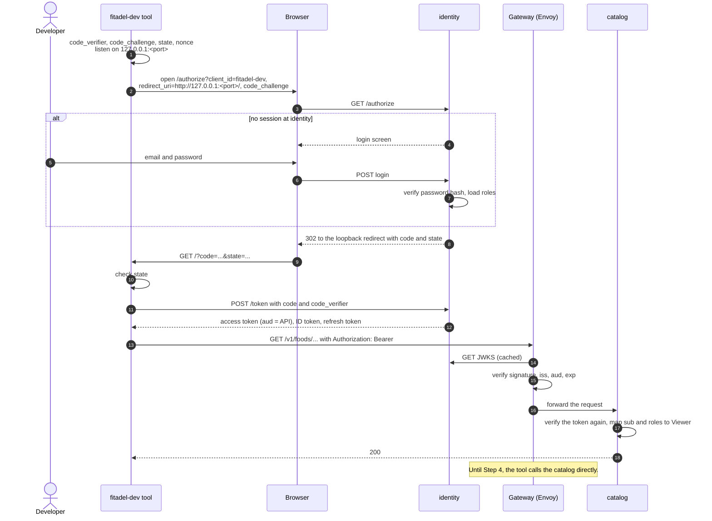

# Authentication and authorization

Fitadel runs its own OpenID Provider, the `identity` service
([ADR-0008](../adr/0008-oidc-provider.md)). Every app and service trusts that one issuer.
External identity providers such as Google sit behind it, so their tokens never reach
Fitadel's APIs.

> **Status:** Phase 2 in progress. Each part below names the step that implements it.
> Until Phase 2 Step 3, the catalog identifies users by development headers
> (`AUTH_MODE=dev-headers`).

## Components

| Component       | Role                                                                                                        | Implemented in  |
| --------------- | ----------------------------------------------------------------------------------------------------------- | --------------- |
| `identity`      | OpenID Provider: accounts, login screens, authorization codes, tokens, JWKS                                 | Phase 2, Step 2 |
| `catalog`       | Resource server: verifies access tokens, maps claims to a `Viewer`, applies ownership and contributor rules | Phase 2, Step 3 |
| Gateway (Envoy) | Edge: routing, coarse token verification, rate limiting                                                     | Phase 2, Step 4 |
| Google          | External identity provider, federated by `identity`                                                         | Phase 2, Step 5 |

## Clients

| Client            | Type                     | Redirect URI                         | Used by                        | Phase |
| ----------------- | ------------------------ | ------------------------------------ | ------------------------------ | ----- |
| `fitadel-dev`     | Public, PKCE             | Loopback, `http://127.0.0.1:<port>/` | Local tools and manual testing | 2     |
| `fitadel-web`     | Confidential (BFF), PKCE | Web app callback                     | Web app                        | 4     |
| `fitadel-android` | Public, PKCE             | App Link (verified HTTPS)            | Android app, via a Custom Tab  | 5     |

## Tokens

| Token         | Audience   | Format                       | Lifetime                                      | Checked by           |
| ------------- | ---------- | ---------------------------- | --------------------------------------------- | -------------------- |
| ID token      | The client | JWT                          | Short                                         | The client only      |
| Access token  | The API    | JWT, `typ: at+jwt`, ES256    | About 10 minutes                              | Gateway and services |
| Refresh token | `identity` | Opaque, stored by `identity` | Rotated on every use; reuse revokes the grant | `identity` only      |

ID tokens tell the client who signed in and are never sent to an API. Access tokens are
verified locally against `identity`'s JWKS, cached and looked up by `kid`.

## From token to `Viewer`

Services verify the signature, the `alg` allowlist, `iss`, `aud`, `exp` and `typ`, then
map the claims:

| Claim   | `Viewer` field | Notes                                              |
| ------- | -------------- | -------------------------------------------------- |
| `sub`   | `id`           | Fitadel's user ID, stable across sign-in methods   |
| `roles` | `roles`        | e.g. `contributor`, allowed to create public foods |

Role changes take effect when the access token is next refreshed.

## Sign-in flow (`fitadel-dev`)

## Trust boundaries

- Services trust only Fitadel's issuer. A Google token is never accepted by an API.
- The gateway strips any incoming copies of headers it sets itself.
- Services verify tokens themselves even behind the gateway, because
  service-to-service calls don't pass through it.
- Ownership and contributor rules live in the services, not at the gateway.

## Accounts and federation (Phase 2, Step 5)

A user can have several sign-in identities, each keyed by issuer and subject, never by
email. `identity` is a client of Google: it validates Google's ID token, finds or creates
the Fitadel user, and then issues Fitadel's own tokens. A Google identity is linked to an
existing account only after the user proves they own that account.
